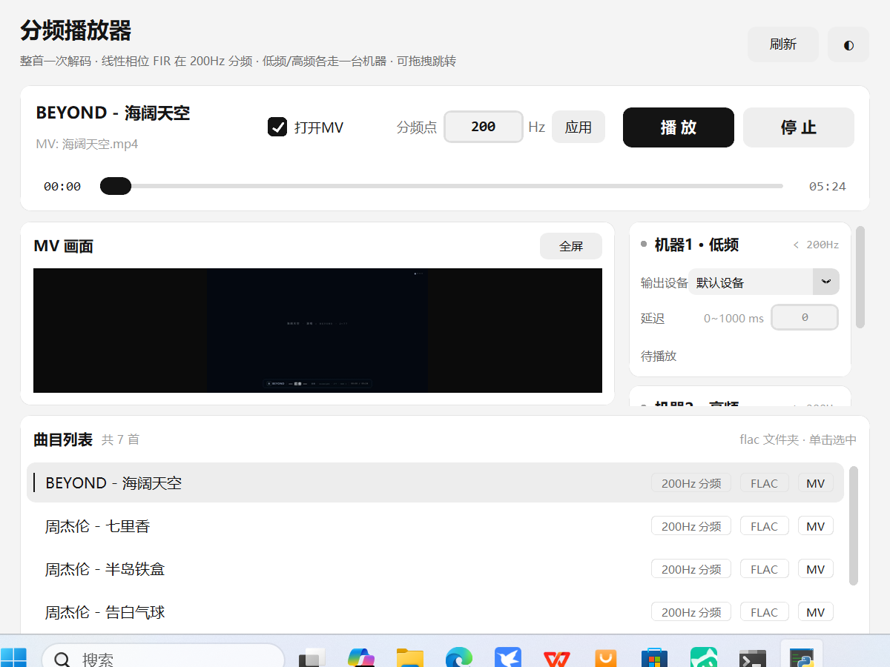
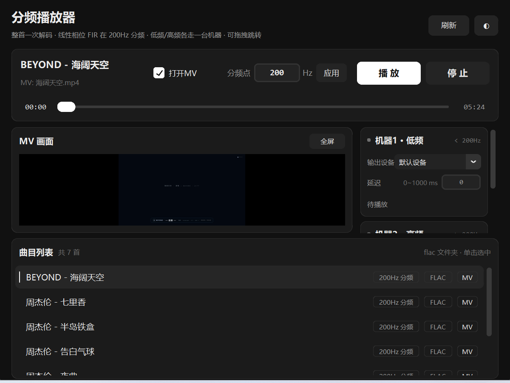

# 岔音 Xover

> 电子分频双路播放器 —— 一首歌按频率拆开，两台机器各推一段到不同音箱。

用一根交叉频率把整首歌切成「低频段」和「高频段」，两段分别送到两台输出设备
（两台机器 / 两个音箱 / 两组功放），并可各自设置延迟对齐。分频采用**线性相位 FIR**，
交叉点精确 −6 dB，两段相位一致、相加可无损还原原信号。

| 浅色 | 深色 |
|---|---|
|  |  |

## 特性

- **线性相位分频**：LP + HP 共享系数（Blackman 窗 + 谱反转），交叉点恒 −6 dB，群延迟严格一致
- **抽头自适应**：抽头数随分频点变化，过渡带相对带宽恒定，低频分频点也不会发虚
- **两路独立输出**：每路独立选输出设备、独立设 0~1000 ms 延迟
- **无缝跳转**：拖动进度条时两路同步移动，路间延迟错位保持不变
- **MV 同步**：以音频位置为主时钟，自动丢帧追赶，支持双击全屏
- **不卡界面**：解码、分频、开设备全在后台线程完成
- **黑白双主题**：右上角 `◐` 切换，选择记入 `settings.json`

## 安装

环境：Windows + Python 3.13（tkinter 随官方安装包自带，无需 pip 安装）

```bash
pip install -r requirements.txt
```

国内网络慢时加镜像：

```bash
pip install -r requirements.txt -i https://pypi.tuna.tsinghua.edu.cn/simple
```

## 运行

```bash
python xover.pyw      # 命令行启动，能看到日志输出
```

也可以直接**双击 `xover.pyw`**（`.pyw` 关联 pythonw，不弹控制台窗口）。

放好素材再启动：

```
flac/   放音频（flac wav mp3 ogg m4a）
mv/     放 MV（mp4 mkv avi mov webm ts m4v flv wmv），与音频同名即自动配对
```

## 使用

| 操作 | 说明 |
|---|---|
| 单击曲目 | 选中并预载（后台完成解码 + 分频） |
| 播放 / 停止 | `空格` 播放暂停 |
| 上 / 下方向键 | 切换曲目 |
| 分频点 | 输入 20~20000 Hz 后回车/点「应用」；播放中改会从当前位置自动重播 |
| 延迟 | 每路 0~1000 ms，用来补偿两台机器/音箱的距离差 |
| 打开MV | 勾选后播放时同步显示画面，双击画面进全屏 |
| 全屏 | 双击画面 / 点「全屏」按钮；`Esc`、`F11`、双击退出 |

> 提示：两路要接**不同**输出设备才有效果。若都选同一个设备，界面会给出提示。

## 目录结构

```
xover.pyw               主程序（单文件）
requirements.txt        依赖清单
settings.json           本地设置（主题偏好），已 gitignore
flac/                   音频素材目录
mv/                     MV 素材目录
docs/                   截图
tests/regression.py     无窗口回归测试
```

## 原理要点

| 环节 | 做法 |
|---|---|
| 解码 | ffmpeg → 44.1 kHz 双声道 float32（避开 miniaudio 对中文路径的兼容问题） |
| 分频 | Blackman 窗线性相位 FIR；高通由低通谱反转导出，两者群延迟相同 |
| 卷积 | FFT 重叠相加，步长 `hop = block - (L-1)`，尾部重叠写回避免块边界台阶 |
| 余量 | 两段共用同一增益归一化，防止单段峰值超 1.0 削波，且不破坏两路响度比 |
| 输出 | 优先 float32，失败退 int16；优先用户指定设备，失败退默认设备 |
| 同步 | 线性相位群延迟整体后移两路起点，声音与画面仍对齐 |

## 许可

[MIT](LICENSE)
